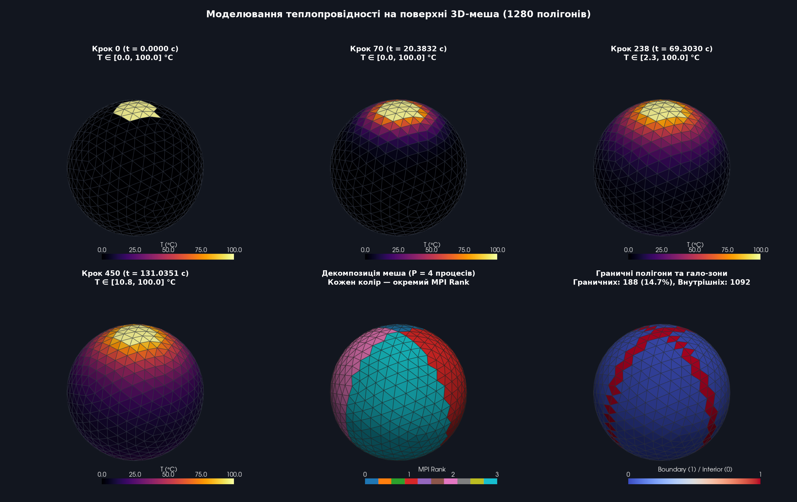
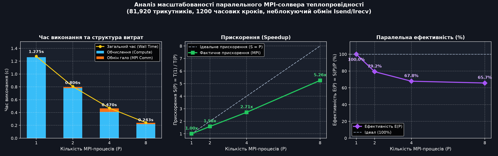

# Паралельне моделювання теплопровідності на 3D-меші (MPI)

Проєкт реалізує чисельне моделювання поширення тепла на поверхні трикутних 3D-мешів (формат STL) з розпаралелюванням за допомогою **MPI (`mpi4py`)**, геометричною декомпозицією області та 3D-візуалізацією у **PyVista**.

---

## Математична модель

Для кожного трикутного полігона $i$ зміна температури описується дискретним оператором Лапласа на графі суміжності меша за явною схемою Ейлера:

$$\frac{dT_i}{dt} = \alpha \sum_{j \in \text{neighbors}(i)} \frac{A_{ij}}{d_{ij}} (T_j - T_i), \qquad T_i^{(n+1)} = T_i^{(n)} + \Delta t \cdot \frac{dT_i}{dt}$$

* $A_{ij}$ — довжина спільного ребра між сусідніми трикутниками $i$ та $j$;
* $d_{ij}$ — евклідова відстань між центроїдами трикутників $i$ та $j$;
* $\alpha$ — коефіцієнт теплопровідності;
* $\Delta t$ — крок за часом, що автоматично обирається за критерієм стійкості CFL.

---

## Структура проєкту

```text
├── src/
│   ├── mesh_loader.py     # Завантаження/генерація STL, центроїди, площі, граф сусідства, CFL
│   ├── solver_seq.py      # Послідовний (одноядерний) солвер за явною схемою Ейлера
│   ├── partitioner.py     # Декомпозиція меша (geometric / contiguous), виділення гало-зон
│   ├── solver_mpi.py      # Паралельний MPI-солвер (Isend/Irecv, Sendrecv, Gatherv)
│   └── visualizer.py      # Експорт у VTK/VTU, генерація 3D GIF-анімації та графіків Speedup
├── run_simulation.py      # CLI-скрипт для запуску симуляції та візуалізації
├── benchmark_mpi.py       # Верифікація на ікосаедрі та бенчмарк прискорення (1, 2, 4, 8 процесів)
├── models/                # Згенеровані та вхідні STL-моделі
└── output/                # Результати (.vtu, .vtk, .gif, .png, .json)
```

---

## Встановлення

Переконайтеся, що в системі встановлено **OpenMPI** або **MPICH** (`mpirun`), після чого встановіть Python-залежності:

```bash
python3 -m venv .venv
source .venv/bin/activate
pip install -r requirements.txt
```

---

## Запуск

### 1. Моделювання та 3D-візуалізація (MPI)

Запуск на 4 процесах MPI зі збереженням результатів у `output/thermal_result.vtu`, `output/thermal_diffusion.gif` та `output/thermal_overview.png`:

```bash
mpirun -n 4 python run_simulation.py --mesh sphere --subdivisions 3 --steps 450 --fixed-source --gif
```

Запуск на власному STL-файлі:

```bash
mpirun -n 4 python run_simulation.py --stl models/sphere_sub4.stl --steps 600 --partition geometric
```

Основні параметри `run_simulation.py`:
* `--stl <path>` — шлях до STL-файлу (якщо не вказано, генерується автоматично);
* `--mesh {icosahedron,sphere,torus}` — тип тестової моделі;
* `--subdivisions <int>` — деталізація сфери (`0` — 20 граней, `3` — 1 280, `4` — 5 120, `6` — 81 920);
* `--partition {geometric,contiguous}` — метод розбиття на піддомени;
* `--comm-mode {isend_irecv,sendrecv}` — схема обміну гало-осередками;
* `--gif` — зберегти GIF-анімацію та PNG-огляд.

### 2. Верифікація та аналіз прискорення (Speedup)

```bash
python benchmark_mpi.py
```

Скрипт перевіряє збереження енергії на ікосаедрі, порівнює методи декомпозиції (`geometric` скорочує обсяг гало-обміну в ~1.6 раза порівняно з `contiguous`) та будує графік масштабованості для `1, 2, 4, 8` MPI-процесів.

---

## Результати



### Масштабованість (81 920 трикутників, 1 200 кроків)

| MPI процесів ($P$) | Час виконання (с) | Прискорення $S(P)$ | Ефективність $E(P)$ | Похибка $\max \|T_{\text{mpi}} - T_{\text{seq}}\|$ |
| :---: | :---: | :---: | :---: | :---: |
| **1** | 1.2753 | 1.00x | 100.0% | `0.00e+00` |
| **2** | 0.8055 | 1.58x | 79.2% | `0.00e+00` |
| **4** | 0.4700 | 2.71x | 67.8% | `0.00e+00` |
| **8** | 0.2426 | 5.26x | 65.7% | `0.00e+00` |


